  

  

🗺️ What's in the room

| Thing | Shows |
|---|---|
| 🪟 Window | Real weather + time of day in Ernakulam (rain, storm flashes, night sky, sunset) |
| 🖼️ Poster | My last 17 weeks of contributions — today's square blinks |
| 📚 Bookshelf | Books = my languages, sized by code volume |
| 💡 Fairy lights | Language colours |
| 🌱 Plant | Grows with my streak, flowers at 7+ days |
| 🟨 Sticky note | Commits today |
| 🧑‍💻 Me | Typing if I committed today — asleep at night if I didn't |
| 🐈 Cat | Sleeps at night |

